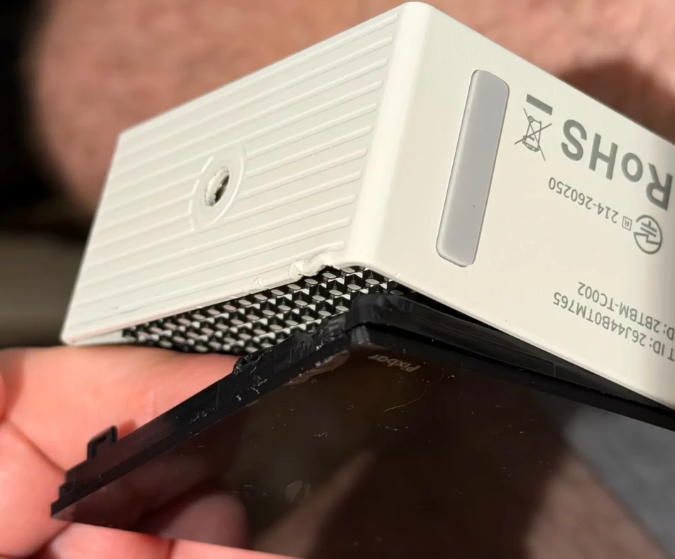
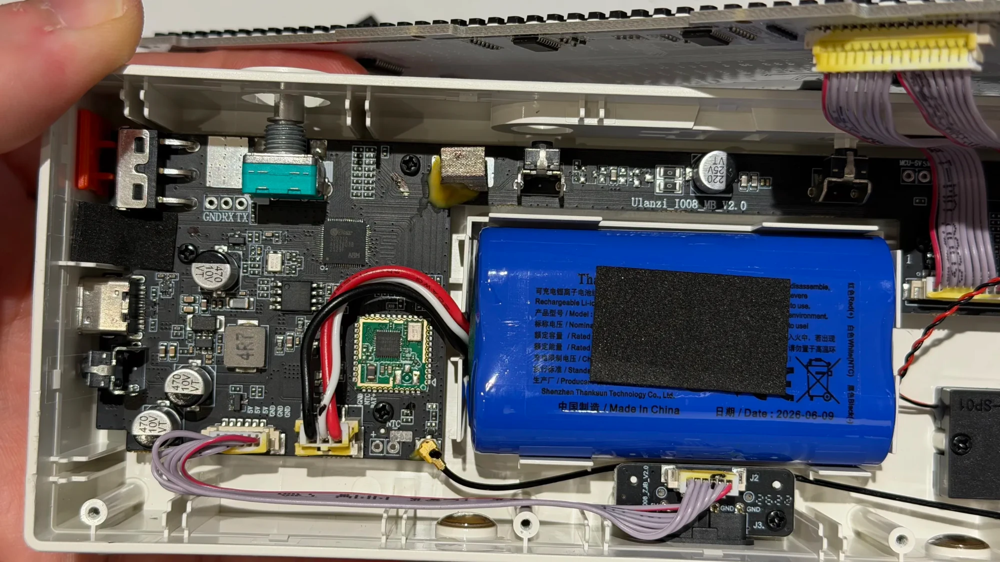
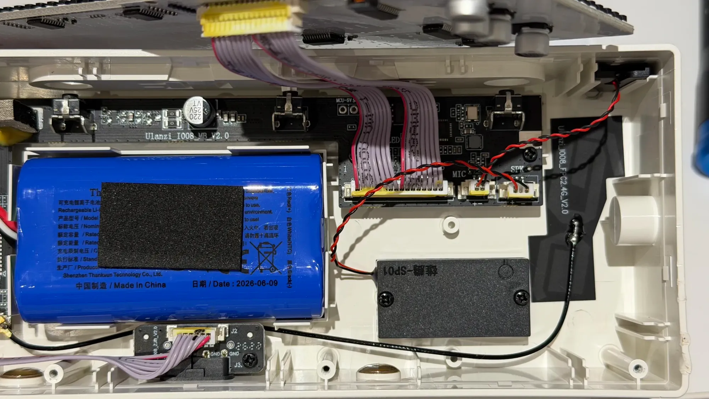

# TEARDOWN.md — inside a TC002, photographed

everything else in these notes was read off a running unit: `/proc`, `/sys`, the device tree,
strings in the app. this is the other half — what the case holds, opened from the front and
photographed, on a unit whose firmware matches *unit B* in [`FINGERPRINTS.md`](FINGERPRINTS.md).

two kinds of claim below, kept apart on purpose:

- **printed** — silkscreen, part markings and labels you can read in the photo
- *inferred* — what a part probably is, from where it sits and what the software already
  established. none of these were probed with a meter

## opening it

the front is a **black diffuser** that prises off: it is clipped into the case, and lifting it at
one end exposes a black **egg-crate louvre**, one cell per led, that keeps each pixel's light to
its own square. the diffuser's inside face is printed **`Pixbar`**. one end of the case carries
the **1/4-inch tripod thread** (*spec*); the long face beside it (*the base, as the clock stands*)
carries a grey window and the regulatory label:

| on the label | |
|---|---|
| **`…D: 2BTBM-TC002`** | *the fcc id*: grantee `2BTBM`, product `TC002`. the start of the line is out of frame. an fcc filing is public and usually includes the manufacturer's own internal photographs |
| **`…T ID: 26J44B0TM765`** | the start is out of frame; *probably the chinese cmiit id* |
| **`R 214-260250`** | beside the japanese giteki mark: the radio-equipment certification number |
| **RoHS**, the crossed-out wheelie bin | the usual european marks |

with the diffuser and the louvre off, the led panel lifts out of the front on its ribbons, and
the rest of these photographs are of the tray behind it.

## the whole thing

the led panel is the front of the tray: it lifts away on **two grey ribbon cables** and everything else lives
in the tray behind it. from left to right as photographed: the soc end of the main board, the
battery, the right-hand end of the main board with the panel, mic and speaker connectors, the
speaker box and the flexible wi-fi antenna. the main board (**`Ulanzi_I008_MB_V2.0`**) runs along
the top edge of the tray; *it appears to be one l-shaped board*, wide at the soc end.

## the main board, soc end

| | |
|---|---|
| soc | **SigmaStar `SSD210`** (printed: `SSD210`, `AV52D03B`, `2529I`, `ARM`). the software only ever said "ssd21x"; the [hardware](README.md#hardware) table's 64 mb in-package dram is the ssd210's |
| serial header | **three through-hole pads silkscreened `GND RX TX`**, unpopulated, right beside the soc. *very likely the kernel console on `ttyS0` at 115200*, which the readme had noted as "whether pads are reachable was not checked". not yet connected to |
| beside the soc | an 8-pin package — *probably the 32 mib spi nor*, markings not legible here — and a crystal |
| wi-fi / bluetooth | a **green castellated module** with a u.fl lead to the antenna on the far right of the tray. its markings are not legible; the software identifies it as the **aicsemi aic8800dc** |
| battery connector | **3-pin, `GND` / `NTC` / `BAT+`**, matching the pack's own label: red (+), white (ntc), black (−) |
| 6-pin header | **`5V 5V 5V GND GND GND`**, ribboned to the small board at the bottom edge |
| usb-c | at the left edge, with the bulk capacitors (`470 µF 10 V`) and a `4R7` inductor of the supply beside it |
| the knob | the teal **rotary encoder** with its threaded shaft (*the `BRI&VOL` knob*; gpio 10 / 11 in the readme) |
| slide switch | a **red three-pin slide switch** at the very edge — *the power switch* |

the battery is a single blue-wrapped pack, **made by Shenzhen Thanksun Technology, dated
2026-06-09**, three leads, its capacity label covered by foam. ulanzi's *spec* is 3.7 v, 3600 mah.

the small board at the bottom edge is **`I008_ZJB_V2.0`** (date code `2624`): `J2` takes the
six-wire ribbon from the main board's 5 v / ground header, `J3` faces out through the base, and
two `GND` pads sit between them. *it is probably the dock's charging contacts*: the readme
measured the dock arriving on the same `vin` as usb-c, which is what a board fed straight from
the 5 v rail would give.

## the main board, panel end

| | |
|---|---|
| panel connector | a wide **pin-1-marked header** labelled `LED`, carrying both grey ribbons to the panel |
| mic / speaker | two 2-pin connectors, **`MIC`** and **`SPK`**, each marked `+ −`, with twisted red/black pairs |
| pads | **`MCU-5V`** test pads above the ribbons |
| the chip here | a qfn with its own crystal, next to the `LED` header and the `MCU-5V` pads — *the pixel mcu* the readme describes between the soc and the leds |
| speaker | a sealed black box marked **`SP01`**, screwed to the tray |
| microphone | *the small part in the top-right corner of the tray*, on the twisted pair that ends at `MIC` |
| antenna | a flexible pcb antenna, **`Ulanzi_I008_FPC2.4G_V2.0`**, stuck to the case wall, fed by the u.fl lead from the wi-fi module |

the mic being wired to this end, beside the mcu, fits what the software showed: the stock app
reads the mic **level** from the mcu (`queryMicValue`), not from the soc's audio input.

## the led panel

the panel with the front diffuser and the louvre off: the **52 × 16 grid of rgb leds** on a white board, with
the led drivers on its back (visible in the first photo). see [`LED-SPI.md`](LED-SPI.md) for how
it is driven.

## the top

the top, with the button bar's cap off: the **left and right buttons' tact switches** show
through their holes, *the middle button is the sprung tab between them*, and the **`BRI&VOL`**
knob is on the right. that is the readme's three buttons across the top plus the knob's own
push, and nothing more.
